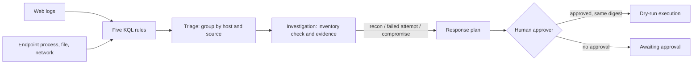

# Case study: PHP2Shell (CVE-2026-109618 and CVE-2026-109619)

A real event from October 2026, replayed through this repository's detection, triage, investigation and
response agents. The attack data is synthetic and every address comes from the RFC 5737 documentation
ranges. No real attacker address, domain or file hash appears here.

## 1. What happened

Two critical bugs in the PHP engine itself, together called PHP2Shell, let a remote attacker with no
login run code on a web server. Both are rated 9.2 on the CVSS v4.0 scale. The bugs sit in the code that handles
multipart form uploads and session upload-progress tracking, so any PHP site that serves web requests was
in scope, and Apache with mod_php was the setup PHP rated riskiest.

Researchers using AI-assisted tooling reported the flaws privately in August. PHP planned a coordinated
release, but the CVE numbers leaked, so it shipped the fixes a day early, on October 21. Governments
reacted fast. US and UK agencies urged immediate patching, and a number of British, Finnish and French
public websites were switched off as a precaution while staff patched them.

Attackers moved quickly too, but mostly failed. Scanning and exploit attempts rose sharply after the
release, and one group tried to install a Mirai-derived botnet called Potassium. One endpoint security
vendor first said it had seen a successful break-in, then withdrew that after a closer look: the attempt
had been blocked and the payload never arrived. As of October 23, no compromise had been confirmed
anywhere. The public exploits needed unusual, lab-like server settings and did not work on PHP's default
configuration, although one research firm showed a private exploit that did work on hardened setups.

## 2. In plain words

A web server runs PHP to build pages. When a visitor uploads a file, PHP can track the upload's progress.
The bug lets an attacker send a huge, carefully shaped upload that pushes PHP into an out-of-memory error
in a place where it does not clean up properly. The leftover memory can then be steered into running the
attacker's code. In practice, attackers follow a familiar pattern: find PHP servers, send the crafted
upload, and, if it works, download a program into `/tmp`, run it, and have it call home.

That pattern is what a security operations centre can see, even without knowing the bug's internals.

## 3. Timeline (public reporting)

| When | What |
|---|---|
| August 2026 | Flaws found with AI-assisted research and reported privately to PHP |
| October 17 | First exploitation attempt seen by one cloud provider |
| October 20 | PHP announces an upcoming security release |
| October 21 | CVE numbers leak; PHP ships 8.5.12, 8.4.27, 8.3.36 and 8.2.35 a day early; CISA urges immediate patching; precautionary takedowns in the UK, Finland and France |
| October 22 | One endpoint security vendor reports a successful exploitation, then corrects it to failed, blocked attempts; the payload was a Mirai variant called Potassium |
| October 23 | Still no confirmed compromise; public exploits fail on default settings; one research firm reports a private exploit that bypasses ASLR on production settings |

## 4. How the agents respond



* **Detection.** Five rules in [`detections/php2shell/`](../../detections/php2shell/README.md), run through
  the repository's KQL interpreter: version fingerprinting from one source, a multipart POST carrying the
  upload-progress field to a route that takes no uploads, a web worker writing an executable to `/tmp`,
  a web worker starting a program from `/tmp`, and a `/tmp` program connecting to a public address.
* **Triage** groups alerts by host and source address, so a scan, the exploit request and the follow-on
  activity from one attacker land in one case.
* **Investigation** looks up each host's PHP version and classifies it as vulnerable, fixed, end of life
  with no patch, needs a backport check, or unknown. It then decides from evidence, not from request
  contents. A crafted POST with nothing after it is a **failed attempt**. A crafted POST followed by
  execution or outbound traffic on the same host is a **confirmed compromise**. Scans alone are **recon**.
* **Severity** follows evidence and patch status: Critical for a compromise, High for a failed attempt on a
  vulnerable host, Medium for one on a fixed host, Low for recon.
* **Response** follows the [takedown vs patch decision record](php2shell-decision-record.md). Isolation is
  only proposed for a confirmed compromise. Every action waits for a listed human approver who approves
  that exact plan digest. The agents cannot approve their own plans, and execution is a dry run.

## 5. Real output

`aisoc php2shell` (deterministic; this block is drift-checked by `tests/test_php2shell.py`):

<!-- php2shell-output -->
```text
PHP2Shell case study (synthetic, offline; documentation IP ranges only)

P2S-001  Low      recon                 hosts=- sources=203.0.113.10
         - version fingerprinting from 203.0.113.10; no exploit request followed
P2S-002  High     failed_attempt        hosts=PCU-WEB01 sources=203.0.113.20
         - crafted POST seen (HTTP 500) but no process, file or outbound evidence after it
         - target runs vulnerable PHP (PCU-WEB01 8.4.26): patch now
         > mitigate_and_patch_now PCU-WEB01 (awaiting human approval)
         > block_ip 203.0.113.20 (awaiting human approval)
P2S-003  Medium   failed_attempt        hosts=PCU-WEB02 sources=203.0.113.30
         - crafted POST seen (HTTP 413) but no process, file or outbound evidence after it
         - target PHP is on a fixed release; the attempt cannot succeed against this flaw
         > block_ip 203.0.113.30 (awaiting human approval)
P2S-004  Critical confirmed_compromise  hosts=PCU-WEB03 sources=203.0.113.40
         - post-exploitation evidence on the host: c2, execution after the crafted POST
         > isolate_host PCU-WEB03 (awaiting human approval)
         > block_ip 203.0.113.40 (awaiting human approval)
P2S-005  Critical confirmed_compromise  hosts=PCU-WEB07 sources=203.0.113.50
         - post-exploitation evidence on the host: c2, execution after the crafted POST
         > isolate_host PCU-WEB07 (awaiting human approval)
         > block_ip 203.0.113.50 (awaiting human approval)
P2S-006  High     failed_attempt        hosts=PCU-WEB05 sources=203.0.113.60
         - crafted POST seen (HTTP 403) but no process, file or outbound evidence after it
         - target runs vulnerable PHP (PCU-WEB05 8.2.34): patch now
         > mitigate_and_patch_now PCU-WEB05 (awaiting human approval)
         > block_ip 203.0.113.60 (awaiting human approval)

Inventory:
  PCU-WEB01  PHP 8.4.26             vulnerable      internet -> mitigate_and_patch_now
  PCU-WEB02  PHP 8.4.27             fixed           internet -> keep_online_monitor
  PCU-WEB03  PHP 8.3.35             vulnerable      internet -> mitigate_and_patch_now
  PCU-WEB04  PHP 8.3.36             fixed           internet -> keep_online_monitor
  PCU-WEB05  PHP 8.2.34             vulnerable      internet -> mitigate_and_patch_now
  PCU-WEB06  PHP 8.5.12             fixed           internet -> keep_online_monitor
  PCU-WEB07  PHP 8.1.31             eol_no_patch    internet -> take_offline_until_migrated
  PCU-WEB08  PHP 8.4.16-1+deb13u2   check_backport  internet -> verify_backport_then_patch
  PCU-WEB09  PHP 8.5.11             vulnerable      internet -> mitigate_and_patch_now
  PCU-WEB10  PHP 7.4.33             eol_no_patch    internal -> restrict_and_migrate
  PCU-WEB11  PHP 8.2.35             fixed           internal -> keep_online_monitor
  PCU-WEB12  PHP 8.4.26             vulnerable      internal -> patch_next_window

Measured:
  events: 1493
  alerts: 19
  precision: 1.0
  story_recall: 1.0
  event_recall: 0.981
  false_positive_alerts: 0
  lookalike_kinds: 8
  lookalike_kinds_alerting: []
  cases: 6
  verdicts_correct: 6
  inventory_correct: 30
  inventory_cases: 30
  actions_planned: 9
  executed_without_approval: 0
  executed_with_agent_self_approval: 0
  executed_with_stale_digest: 0
  executed_with_human_approval: 9
```
<!-- php2shell-output -->

## 6. Measured results

On 1,493 synthetic events (six attack stories, eight kinds of benign look-alike, background traffic):

| Measure | Result |
|---|---|
| Alert precision | 1.0 (19 of 19 alerts were attack activity) |
| Attack stories detected | 6 of 6 |
| Attack events covered by an alert | 98.1% (the `sh -c cd /tmp; wget ...` step is missed, see limitations) |
| False positives on look-alikes | 0 alerts across 8 look-alike kinds |
| Verdicts correct (recon / failed / compromise) | 6 of 6 cases |
| Inventory classifier correct | 30 of 30 version strings, including exact fixed-release boundaries |
| Containment executed without approval | 0 of 9 planned actions |
| Executed with an agent approving itself, or a stale plan digest | 0 and 0 |
| Executed with a valid human approval (dry run) | 9 of 9 |

The look-alikes are real uploads with progress tracking on upload routes, the authorised internal scanner,
a contact form with attachments, ImageMagick started by php-fpm, a deploy job running a build tool from
`/tmp`, a backup agent calling out, an analyst's sandbox writing to `/tmp`, and sendmail with a `/tmp`
queue directory.

## 7. Lessons

1. **Inventory first.** Most of the work was knowing which hosts ran which PHP version. The classifier is
   the piece every other step depends on, and distribution builds make the version string unreliable.
2. **Attempt is not compromise.** The early vendor correction shows how easy it is to over-call. The
   agents only call a compromise when the host itself shows follow-on activity.
3. **Detect the behaviour, not the bug.** Rules on `/tmp` execution and outbound calls would catch the
   next web-server flaw too.
4. **Takedowns have a cost.** A blanket takedown treats a fixed internal host like an exposed end-of-life
   one. Deciding per host keeps services up where the risk is closed.

## 8. Limitations

* All telemetry is synthetic and written by the same author as the rules, so the perfect precision says
  the rules match this pattern, not that they would be this clean on real traffic.
* The shell step that downloads the payload is missed: the rule looks for `/tmp/` in a path, and
  `cd /tmp; wget` does not contain it. A rule for web workers starting shells or downloaders is planned.
* The probe rule depends on a parsed upload-progress field, which real web logs usually do not record; it
  needs a web application firewall or reverse proxy that logs multipart parts.
* Version detection cannot see backported fixes or hidden version headers.
* The case-study rules are not in `detections/rules.json`, so Terraform and Bicep do not deploy them.

## 9. Built vs simulated

| Item | Status |
|---|---|
| Five KQL rules run over the case-study tables | Built and tested |
| PHP inventory classifier with 30 labelled cases | Built and tested |
| Triage, investigation verdicts and severity | Built and tested |
| Approval-gated response plan, dry-run executor | Built and tested |
| Telemetry, hosts, attacker addresses | Simulated (RFC 5737 ranges) |
| Rules deployed to Microsoft Sentinel | Planned |
| Real web application firewall or endpoint data | Planned |
| A rule for web workers starting shells or downloaders | Planned |

## 10. References

* SecurityWeek, "Mirai Botnet Operators Join PHP2Shell Attacks as ASLR Bypass Exploits Emerge", October 23, 2026: https://www.securityweek.com/mirai-botnet-operators-join-php2shell-attacks-as-aslr-bypass-exploits-emerge/
* Sophos, "Proof-of-concept exploit released for PHP vulnerabilities (CVE-2026-109618, CVE-2026-109619)", updated October 21 to 23, 2026: https://www.sophos.com/en-us/blog/proof-of-concept-exploit-released-for-php-vulnerabilities-109618-109619
* CISA, "Critical Vulnerabilities in PHP Require Immediate Patching", October 21, 2026: https://www.cisa.gov/news-events/alerts/2026/10/21/critical-vulnerabilities-php-require-immediate-patching
* NPR, coverage of the PHP flaws, October 23, 2026: https://www.npr.org/2026/10/23/g-s1-149503/hacking-php-flaws
* AP, coverage of the PHP vulnerability and European takedowns, October 2026: https://apnews.com/article/php-websites-fbi-europe-vulnerability-a0af9576808a0963efca8df14d4b5183
