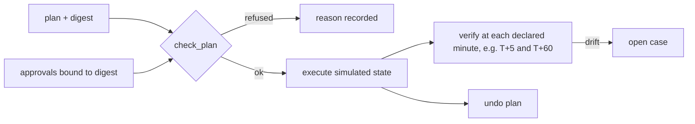

# Component: authority registry, verification and undo

An agent that can disable accounts needs a written answer to four questions per action: who owns it, what
evidence and how many approvals it needs, how we check it worked, and how we undo it. The registry answers
them in configuration; the executor refuses anything that does not match, verifies after acting, and keeps
an undo plan. It includes quarantine for a misbehaving AI agent.

Sections: [1. Purpose](#1-purpose) · [2. Architecture](#2-architecture) · [3. How it works](#3-how-it-works) · [4. Key files](#4-key-files) · [5. Code excerpts](#5-code-excerpts) · [6. Configuration](#6-configuration) · [7. Commands](#7-commands) · [8. Real output](#8-real-output) · [9. Tests and gates](#9-tests-and-gates) · [10. Guardrails](#10-guardrails) · [11. Security and governance](#11-security-and-governance) · [12. Observability](#12-observability) · [13. Failure modes](#13-failure-modes) · [14. Mapping to Azure services](#14-mapping-to-azure-services) · [15. Limitations](#15-limitations) · [16. Interview talking points](#16-interview-talking-points)

## 1. Purpose

* Make action authority explicit and reviewable per action, with staged autonomy that never reaches stage 4
  (unattended) in this repository.
* Catch actions that do not stick, such as a directory sync re-enabling a disabled account.
* Contain an AI agent the same way as a user: identity off, tool connections cut, credential revoked.

## 2. Architecture



## 3. How it works

1. A plan lists steps and evidence; its digest binds approvals to exactly that plan.
2. `check_plan` refuses unknown actions, approvers outside the tenant, approvals for a different digest,
   missing evidence, low consensus and break-glass targets, and counts distinct approvers only.
3. `execute` applies each action's declared effect to a simulated state; `verify` re-checks at the
   declared times while `Drift` replays changes from other systems.
4. `undo` restores the recorded prior values. `promote` reports whether an action could move up a stage
   and refuses to apply stage 4.

## 4. Key files

| File | Role |
|---|---|
| `src/aisoc/authority.py` | Registry, plans, approvals, execution, verification, undo, promotion |
| `config/authority.yaml` | Per-action stage, owner, approvals, evidence, blast radius, effect, checks, undo |
| `tests/test_authority.py` | Refusals, execution, drift, undo, agent quarantine |

## 5. Code excerpts

<!-- code: src/aisoc/authority.py::check_plan -->
```python
def check_plan(plan: Plan, approvals: list[Approval]) -> list[str]:
    problems = []
    ten = get(plan.tenant)
    good = {a.by for a in approvals if a.digest == plan.digest and a.by in ten.approvers}
    stale = [a.by for a in approvals if a.digest != plan.digest]
    if stale:
        problems.append(f"approval(s) from {', '.join(stale)} were for a different plan")
    for act, target in plan.steps:
        spec = actions().get(act)
        if spec is None:
            problems.append(f"{act}: not in the authority registry")
            continue
        if spec["stage"] >= 4 or spec["stage"] > registry()["max_stage"]:
            problems.append(f"{act}: stage {spec['stage']} is above the allowed maximum")
        if len(good) < spec["approvals"]:
            problems.append(f"{act} on {target}: needs {spec['approvals']} approval(s) from tenant approvers, has {len(good)}")
        missing = set(spec["evidence"]) - plan.evidence
        if missing:
            problems.append(f"{act} on {target}: missing evidence {sorted(missing)}")
        if plan.agree < spec["min_agree"] or plan.confidence < spec["min_confidence"]:
            problems.append(
                f"{act} on {target}: consensus {plan.agree}/4 at {plan.confidence:.2f} is below {spec['min_agree']}/4 at {spec['min_confidence']}"
            )
        if target in ten.break_glass:
            problems.append(f"{act} on {target}: break-glass accounts are never contained automatically")
    return problems
```
<!-- /code -->

<!-- code: src/aisoc/authority.py::verify -->
```python
def verify(outcomes: list[Outcome], state: dict, drift: Drift | None = None) -> list[str]:
    """Re-check each executed action at its verify_after minutes; returns human cases opened for failures."""
    drift = drift or Drift()
    opened = []
    minutes = sorted({m for o in outcomes if o.status == "executed" for m in actions()[o.action]["verify_after"]})
    for m in minutes:
        drift.apply(state, m)
        for o in outcomes:
            if o.status != "executed" or m not in actions()[o.action]["verify_after"]:
                continue
            for k, v in effects(o.action, o.target):
                ok = state.get(k) == v
                o.checks.append((m, ok, f"{k} = {state.get(k)}"))
                if not ok and not any(o.action in c and o.target in c for c in opened):
                    opened.append(f"verification failed at T+{m} min: {o.action} on {o.target} ({k} is {state.get(k)}): human case opened")
    return opened
```
<!-- /code -->

## 6. Configuration

All authority lives in `config/authority.yaml`. The AI-agent quarantine entry needs two approvals.

## 7. Commands

```bash
aisoc authority
```

## 8. Real output

Simulated state; measured on the scenarios.

<!-- output: authority -->
```text
Authority registry (config/authority.yaml)

  action                      stage  owner              approvals  blast radius
  disable_user                3      soc.lead           1          one account
  revoke_sessions             3      soc.lead           1          one account's sign-in sessions
  isolate_host                3      soc.lead           1          one device
  block_ip                    3      soc.lead           1          one address for every user
  reset_password              2      it.helpdesk        1          one account
  remove_inbox_rule           3      soc.lead           1          one mailbox rule
  revoke_oauth_grant          3      soc.lead           1          one app's access for one user
  block_legacy_auth_for_user  2      identity.team      1          one account's old mail protocols
  remove_persistence          2      soc.lead           1          one autostart item
  kill_process                2      soc.lead           1          one process
  quarantine_ai_agent         3      ai.platform.owner  2          one AI agent and its tool connections

Scenarios (simulated tenant state, dry run):
- account takeover; directory sync re-enables the user  [plan b29ed2daf8762736]
    executed: revoke_sessions on dana.ruiz@orchidvalley.example
      verify T+5: ok (user:dana.ruiz@orchidvalley.example:sessions = 0)
      verify T+60: ok (user:dana.ruiz@orchidvalley.example:sessions = 0)
    executed: disable_user on dana.ruiz@orchidvalley.example
      verify T+5: ok (user:dana.ruiz@orchidvalley.example:enabled = False)
      verify T+60: FAILED (user:dana.ruiz@orchidvalley.example:enabled = True)
    verification failed at T+60 min: disable_user on dana.ruiz@orchidvalley.example (user:dana.ruiz@orchidvalley.example:enabled is True): human case opened
    undo plan restores the starting state exactly: True
- inbox rule removed, app grant left in place  [plan 827dbecef3169e92]
    executed: remove_inbox_rule on gus.moreau@orchidvalley.example
      verify T+5: ok (mailbox:gus.moreau@orchidvalley.example:hiding_rule = False)
      verify T+60: FAILED (mailbox:gus.moreau@orchidvalley.example:hiding_rule = True)
    verification failed at T+60 min: remove_inbox_rule on gus.moreau@orchidvalley.example (mailbox:gus.moreau@orchidvalley.example:hiding_rule is True): human case opened
    undo plan restores the starting state exactly: True
- inbox rule removed and app grant revoked  [plan 48167048048fec85]
    executed: remove_inbox_rule on gus.moreau@orchidvalley.example
      verify T+5: ok (mailbox:gus.moreau@orchidvalley.example:hiding_rule = False)
      verify T+60: ok (mailbox:gus.moreau@orchidvalley.example:hiding_rule = False)
    executed: revoke_oauth_grant on gus.moreau@orchidvalley.example
      verify T+5: ok (grant:gus.moreau@orchidvalley.example:active = False)
      verify T+60: ok (grant:gus.moreau@orchidvalley.example:active = False)
    undo plan restores the starting state exactly: True
- no approval  [plan c1241940e5e1f984]
    refused: disable_user on kai.lund@orchidvalley.example (disable_user on kai.lund@orchidvalley.example: needs 1 approval(s) from tenant approvers, has 0)
- approval for a different plan  [plan c1241940e5e1f984]
    refused: disable_user on kai.lund@orchidvalley.example (approval(s) from ciso@orchidvalley.example were for a different plan; disable_user on kai.lund@orchidvalley.example: needs 1 approval(s) from tenant approvers, has 0)
- AI agent quarantine (Microsoft Foundry agent, two approvals)  [plan 30e868b51fd09d20]
    signal: guardrail blocked 4 tool calls to send_email with an external recipient in 10 minutes
    signal: prompt shield flagged an instruction hidden in an uploaded invoice
    signal: agent asked for a tool outside its allow-list (export_all_invoices)
    with one approval: refused (quarantine_ai_agent on ap-invoice-assistant: needs 2 approval(s) from tenant approvers, has 1)
    executed: quarantine_ai_agent on ap-invoice-assistant
      verify T+5: ok (agent:ap-invoice-assistant:identity_enabled = False)
      verify T+5: ok (agent:ap-invoice-assistant:tool_connections = 0)
      verify T+5: ok (agent:ap-invoice-assistant:credential_valid = False)
      verify T+60: ok (agent:ap-invoice-assistant:identity_enabled = False)
      verify T+60: ok (agent:ap-invoice-assistant:tool_connections = 0)
      verify T+60: ok (agent:ap-invoice-assistant:credential_valid = False)
    undo plan restores the starting state exactly: True

Promotion check:
  revoke_sessions: stage 4 proposed for a person to decide (not applied; containment stays approval-gated)
  reset_password: stage 3 proposed for a person to decide
  disable_user: stays at stage 3 (6 verified run(s), 1 failed)

Measured (simulated):
  actions_in_registry: 11
  actions_at_stage_4: 0
  scenarios: 6
  actions_executed_dry_run: 6
  actions_refused: 2
  verification_failures_caught: 2
  undo_restores_exact_state: 6/6
  agent_quarantine_with_one_approval: refused
```
<!-- /output -->

## 9. Tests and gates

`tests/test_authority.py` (30 tests): every action has every governance field, every refusal path, exact
undo, drift caught, the companion action that stops drift, two-approval agent quarantine. Gate check:
"no action at stage 4; undo restores state".

## 10. Guardrails

No stage 4. Approvals are bound to a digest. Break-glass accounts are never targets. Same approver twice
counts once.

## 11. Security and governance

Owners are named per action; the registry is the reviewable record of what the SOC is allowed to do.

## 12. Observability

Each outcome prints its checks with times; a failed check opens a case with the reason.

## 13. Failure modes

| Failure | Effect | Handling |
|---|---|---|
| Directory sync re-enables the user | Containment silently undone | T+60 check fails and opens a case |
| Inbox rule removed, app grant left | Attacker recreates the rule | Scenario shows the drift; revoke the grant too |
| Approval reused for another plan | Unapproved action | Digest mismatch refuses |
| Agent keeps a token | Agent acts after quarantine | Credential invalidation is part of the effect |

## 14. Mapping to Azure services

| Here | In Azure |
|---|---|
| Registry | Configuration reviewed in source control; Logic App per action |
| Users, sessions, AI agent identities | Entra ID (agent identities and workload identities) |
| Host isolation | Defender XDR device actions |
| Agent tool connections | Foundry agent connections |
| Verification and audit | Microsoft Sentinel and Azure Monitor |

## 15. Limitations

* Execution is simulated over a dictionary of state; nothing calls a real API.
* Drift is scripted per scenario.

## 16. Interview talking points

* "Every action has an owner, an evidence list, a check after and an undo, written in one file."
* "The verification step caught directory sync quietly re-enabling a disabled account."
* "Quarantining a rogue AI agent needs two people, and cuts identity, tools and credentials together."
