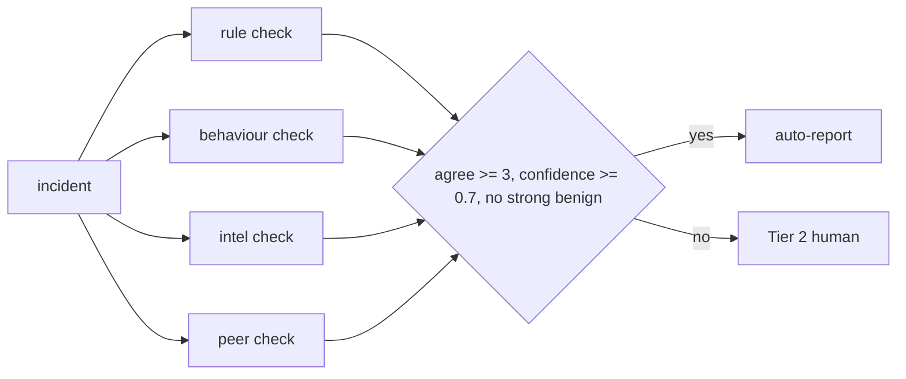

# Component: consensus gate before auto-reporting

Letting one rule's verdict auto-report an incident to a customer is how false alarms reach a client's inbox.
This gate asks four independent checks (rule, behaviour, threat intel and peer comparison) and auto-reports
only when enough of them agree, confidence is high and no check strongly says benign.

Sections: [1. Purpose](#1-purpose) · [2. Architecture](#2-architecture) · [3. How it works](#3-how-it-works) · [4. Key files](#4-key-files) · [5. Code excerpts](#5-code-excerpts) · [6. Configuration](#6-configuration) · [7. Commands](#7-commands) · [8. Real output](#8-real-output) · [9. Tests and gates](#9-tests-and-gates) · [10. Guardrails](#10-guardrails) · [11. Security and governance](#11-security-and-governance) · [12. Observability](#12-observability) · [13. Failure modes](#13-failure-modes) · [14. Mapping to Azure services](#14-mapping-to-azure-services) · [15. Limitations](#15-limitations) · [16. Interview talking points](#16-interview-talking-points)

## 1. Purpose

* Let the SOC report confirmed incidents to customers without a human in the loop only when independent
  evidence agrees.
* Measure the trade-off honestly: how many true positives the gate sends to a human instead.

## 2. Architecture



## 3. How it works

1. Each check votes malicious, benign or abstain, with a reason and a strength.
2. `decide` counts malicious votes, applies the confidence floor and a veto for any strong benign vote.
3. `evaluate` compares the gate with a rule-only baseline and sweeps the agreement threshold.

## 4. Key files

| File | Role |
|---|---|
| `src/aisoc/consensus.py` | Checks, decision, baseline, sweep, report |
| `tests/test_consensus.py` | No false auto-reports, veto, sweep order |

## 5. Code excerpts

<!-- code: src/aisoc/consensus.py::decide -->
```python
def decide(case: Case, min_agree: int = MIN_AGREE) -> Decision:
    votes = tuple(c(case) for c in CHECKS)
    agree = sum(v.vote == "malicious" for v in votes)
    strong_benign = [v.check for v in votes if v.vote == "benign" and v.strong]
    conf = case.incident.confidence if case.incident.verdict == "true_positive" else 0.0
    if strong_benign:
        return Decision(case.incident.id, votes, False, f"strong benign signal from {', '.join(strong_benign)}: Tier 2 reads it first")
    if agree < min_agree:
        return Decision(case.incident.id, votes, False, f"{agree}/4 checks agree (need {min_agree}): Tier 2 reads it first")
    if conf < MIN_CONFIDENCE:
        return Decision(case.incident.id, votes, False, f"model confidence {conf:.2f} below {MIN_CONFIDENCE}: Tier 2 reads it first")
    return Decision(case.incident.id, votes, True, f"{agree}/4 checks agree, confidence {conf:.2f}: report goes out, analyst reviews after")
```
<!-- /code -->

## 6. Configuration

`MIN_AGREE` and `MIN_CONFIDENCE` are constants in `consensus.py`.

## 7. Commands

```bash
aisoc consensus
```

## 8. Real output

Measured on the synthetic learning run.

<!-- output: consensus -->
```text
Consensus gate before auto-reporting (synthetic tenants)

TIER 2      INC-BR-001  rule=unsure  behaviour=unsure  intel=unsure  peer=unsure
            0/4 checks agree (need 3): Tier 2 reads it first
TIER 2      INC-BR-004  rule=unsure  behaviour=benign  intel=unsure  peer=unsure
            0/4 checks agree (need 3): Tier 2 reads it first
TIER 2      INC-BR-008  rule=malicious  behaviour=unsure  intel=unsure  peer=unsure
            1/4 checks agree (need 3): Tier 2 reads it first
TIER 2      INC-BR-011  rule=unsure  behaviour=benign  intel=unsure  peer=benign!
            strong benign signal from peer: Tier 2 reads it first
TIER 2      INC-BR-013  rule=unsure  behaviour=benign  intel=unsure  peer=benign!
            strong benign signal from peer: Tier 2 reads it first
AUTO-REPORT INC-BR-015  rule=malicious  behaviour=malicious  intel=malicious  peer=unsure
            3/4 checks agree, confidence 1.00: report goes out, analyst reviews after
TIER 2      INC-BR-016  rule=unsure  behaviour=benign  intel=unsure  peer=benign!
            strong benign signal from peer: Tier 2 reads it first
TIER 2      INC-BR-023  rule=unsure  behaviour=benign  intel=unsure  peer=benign!
            strong benign signal from peer: Tier 2 reads it first
TIER 2      INC-BR-027  rule=malicious  behaviour=unsure  intel=malicious  peer=unsure
            2/4 checks agree (need 3): Tier 2 reads it first
TIER 2      INC-BR-029  rule=unsure  behaviour=benign  intel=unsure  peer=benign!
            strong benign signal from peer: Tier 2 reads it first
TIER 2      INC-BR-036  rule=malicious  behaviour=malicious  intel=unsure  peer=unsure
            2/4 checks agree (need 3): Tier 2 reads it first
TIER 2      INC-BR-037  rule=unsure  behaviour=benign  intel=unsure  peer=benign!
            strong benign signal from peer: Tier 2 reads it first
TIER 2      INC-OR-001  rule=unsure  behaviour=unsure  intel=unsure  peer=unsure
            0/4 checks agree (need 3): Tier 2 reads it first
TIER 2      INC-OR-004  rule=unsure  behaviour=benign  intel=unsure  peer=unsure
            0/4 checks agree (need 3): Tier 2 reads it first
TIER 2      INC-OR-008  rule=malicious  behaviour=unsure  intel=unsure  peer=unsure
            1/4 checks agree (need 3): Tier 2 reads it first
TIER 2      INC-OR-011  rule=malicious  behaviour=unsure  intel=malicious  peer=unsure
            2/4 checks agree (need 3): Tier 2 reads it first
TIER 2      INC-OR-012  rule=unsure  behaviour=benign  intel=unsure  peer=benign!
            strong benign signal from peer: Tier 2 reads it first
TIER 2      INC-OR-014  rule=unsure  behaviour=benign  intel=unsure  peer=benign!
            strong benign signal from peer: Tier 2 reads it first
TIER 2      INC-OR-016  rule=unsure  behaviour=benign  intel=unsure  peer=benign!
            strong benign signal from peer: Tier 2 reads it first
TIER 2      INC-OR-023  rule=unsure  behaviour=benign  intel=unsure  peer=benign!
            strong benign signal from peer: Tier 2 reads it first
TIER 2      INC-OR-025  rule=unsure  behaviour=benign  intel=unsure  peer=benign!
            strong benign signal from peer: Tier 2 reads it first
TIER 2      INC-OR-028  rule=unsure  behaviour=benign  intel=unsure  peer=benign!
            strong benign signal from peer: Tier 2 reads it first
TIER 2      INC-OR-032  rule=malicious  behaviour=benign  intel=malicious  peer=unsure
            2/4 checks agree (need 3): Tier 2 reads it first
TIER 2      INC-OR-036  rule=unsure  behaviour=benign  intel=unsure  peer=benign!
            strong benign signal from peer: Tier 2 reads it first
TIER 2      INC-PI-001  rule=unsure  behaviour=unsure  intel=unsure  peer=unsure
            0/4 checks agree (need 3): Tier 2 reads it first
TIER 2      INC-PI-004  rule=unsure  behaviour=benign  intel=unsure  peer=unsure
            0/4 checks agree (need 3): Tier 2 reads it first
TIER 2      INC-PI-008  rule=malicious  behaviour=unsure  intel=unsure  peer=unsure
            1/4 checks agree (need 3): Tier 2 reads it first
TIER 2      INC-PI-011  rule=malicious  behaviour=benign  intel=malicious!  peer=unsure
            2/4 checks agree (need 3): Tier 2 reads it first
TIER 2      INC-PI-012  rule=unsure  behaviour=benign  intel=unsure  peer=benign!
            strong benign signal from peer: Tier 2 reads it first
TIER 2      INC-PI-014  rule=unsure  behaviour=benign  intel=unsure  peer=benign!
            strong benign signal from peer: Tier 2 reads it first
TIER 2      INC-PI-016  rule=unsure  behaviour=benign  intel=unsure  peer=benign!
            strong benign signal from peer: Tier 2 reads it first
TIER 2      INC-PI-022  rule=malicious  behaviour=malicious  intel=unsure  peer=unsure
            2/4 checks agree (need 3): Tier 2 reads it first
TIER 2      INC-PI-024  rule=unsure  behaviour=benign  intel=unsure  peer=benign!
            strong benign signal from peer: Tier 2 reads it first
TIER 2      INC-PI-029  rule=unsure  behaviour=benign  intel=unsure  peer=benign!
            strong benign signal from peer: Tier 2 reads it first
TIER 2      INC-PI-032  rule=malicious  behaviour=malicious  intel=unsure  peer=unsure
            2/4 checks agree (need 3): Tier 2 reads it first
TIER 2      INC-PI-036  rule=unsure  behaviour=malicious  intel=malicious  peer=unsure
            2/4 checks agree (need 3): Tier 2 reads it first
TIER 2      INC-PI-037  rule=unsure  behaviour=benign  intel=unsure  peer=benign!
            strong benign signal from peer: Tier 2 reads it first

Measured (gold labels; synthetic data):
  incidents: 110
  true_positives: 9
  auto_reported: 1
  false_auto_reports: 0
  baseline_rule_only_auto_reported: 17
  baseline_false_auto_reports: 9
  true_positives_sent_to_tier2: 8
  handled_end_to_end: 74/110 (67.3%)
  containment_started_by_gate: 0
  sweep_min_agree: {1: '9 auto-reported, 0 false', 2: '9 auto-reported, 0 false', 3: '1 auto-reported, 0 false', 4: '0 auto-reported, 0 false'}
```
<!-- /output -->

## 9. Tests and gates

`tests/test_consensus.py` (8 tests): no false auto-reports, the baseline would have some, the sweep is
monotonic, the veto holds. Gate check: "no false auto-report through the consensus gate".

## 10. Guardrails

The gate can only report; it never starts containment. A strong benign vote always wins.

## 11. Security and governance

Auto-reports are recorded with each vote and reason, so a customer can see why they were told.

## 12. Observability

Each decision prints the four votes with reasons; the report shows the sweep and the baseline.

## 13. Failure modes

| Failure | Effect | Handling |
|---|---|---|
| Correlated checks | Agreement overstated | Checks use different data: rule, behaviour, intel, peers |
| Threshold too strict | True positives go to humans | Measured and shown in the sweep |
| Threshold too loose | False auto-reports | Confidence floor and veto; measured at zero |

## 14. Mapping to Azure services

| Here | In Azure |
|---|---|
| Rule check | Microsoft Sentinel analytics rule result |
| Behaviour check | UEBA anomalies in Microsoft Sentinel and Defender XDR |
| Intel check | Threat-intel matches in Microsoft Sentinel |
| Peer check and decision | Foundry agent with the decision logged to Azure Monitor |
| Approver identities | Entra ID |

## 15. Limitations

* The gate is strict on this data: one auto-report out of 110 incidents, with 8 true positives sent to Tier 2.
* The threshold sweep shows the confidence floor and the veto do most of the work, not the agreement count.

## 16. Interview talking points

* "Rule-only would have auto-reported nine false alarms; the gate reported zero."
* "I show the cost too: eight real attacks went to a human because the checks did not agree."
