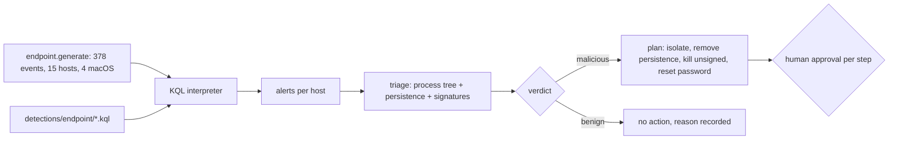

# Component: endpoint triage agent (Windows and macOS)

An endpoint alert is only useful if someone can say what started it and what it left behind. This pack runs
four detections over synthetic Windows and macOS telemetry, then a triage agent rebuilds the process tree
for the alert, lists autostart items, scores the case, and writes a remediation plan in plain English where
every step waits for approval.

Sections: [1. Purpose](#1-purpose) · [2. Architecture](#2-architecture) · [3. How it works](#3-how-it-works) · [4. Key files](#4-key-files) · [5. Code excerpts](#5-code-excerpts) · [6. Configuration](#6-configuration) · [7. Commands](#7-commands) · [8. Real output](#8-real-output) · [9. Tests and gates](#9-tests-and-gates) · [10. Guardrails](#10-guardrails) · [11. Security and governance](#11-security-and-governance) · [12. Observability](#12-observability) · [13. Failure modes](#13-failure-modes) · [14. Mapping to Azure services](#14-mapping-to-azure-services) · [15. Limitations](#15-limitations) · [16. Interview talking points](#16-interview-talking-points)

## 1. Purpose

* Detect four endpoint patterns that matter to small businesses: autostart persistence (Run keys, scheduled
  tasks, LaunchAgents), a service from a temporary path, abuse of remote-management tools, and ransomware
  canary files being touched.
* Clear signed look-alikes at triage, so an analyst sees why an alert was closed.
* Cover macOS as a first-class story, not a footnote.

## 2. Architecture



## 3. How it works

1. `generate` builds Brightwater Logistics endpoints with three stories (a remote-management installer that
   leads to ransomware staging, a service dropped in a temporary folder that dumps credentials, and a fake
   PDF converter on macOS that installs a LaunchAgent) and six look-alike kinds.
2. `detect` runs four rules written as six queries; autostart covers Run keys, scheduled tasks and
   LaunchAgents.
3. `triage` builds the process tree from parent links and keeps only branches that contain an alerted or
   unsigned process; `persistence_items` lists autostart entries with their signature state.
4. The score adds weight for unsigned binaries in user-writable folders, credential-theft behaviour and
   canary access, and removes it when every event comes from a trusted signer. The plan is built from
   registered actions only and never kills a signed process.

## 4. Key files

| File | Role |
|---|---|
| `src/aisoc/endpoint.py` | Telemetry, detection run, process tree, persistence, triage, plan, evaluation |
| `detections/endpoint/rules.yaml` | Rule metadata with the query files per rule |
| `detections/endpoint/*.kql` | The six queries |
| `tests/test_endpoint.py` | Stories, look-alikes, tree, persistence, plan rules |

## 5. Code excerpts

<!-- code: detections/endpoint/run-key-user-writable.kql -->
```kusto
// Windows autostart: a Run or RunOnce value that starts a program from a folder any user can write to,
// set by a process without a trusted signature. Signed per-user apps (chat clients) are excluded.
DeviceRegistryEvents
| where ActionType == "RegistryValueSet" and RegistryKey has "CurrentVersion\\Run"
| where (RegistryValueData contains "\\AppData\\" or RegistryValueData contains "\\Temp\\" or RegistryValueData contains "\\Users\\Public\\" or RegistryValueData contains "\\ProgramData\\") and InitiatingProcessTrusted == false
| project TimeGenerated, DeviceName, RegistryKey, RegistryValueName, RegistryValueData, InitiatingProcessFileName, EventId
```
<!-- /code -->

<!-- code: src/aisoc/endpoint.py::process_tree -->
```python
def process_tree(data: PackData, host: str, around: datetime, hours: float = 3) -> list[str]:
    """Indented lineage of every process on the host within +-hours of the alert, roots first."""
    procs = [r for r in _rows(data, "DeviceProcessEvents", host) if abs((r["TimeGenerated"] - around).total_seconds()) <= hours * 3600]
    nodes = {
        r["ProcessId"]: ProcNode(r["ProcessId"], r["FileName"], r["FolderPath"], r["ProcessCommandLine"], r["Trusted"], r["TimeGenerated"])
        for r in procs
    }
    roots = []
    for r in procs:
        parent = nodes.get(r["InitiatingProcessId"])
        (parent.children if parent else roots).append(nodes[r["ProcessId"]])
    lines: list[str] = []

    def walk(n: ProcNode, depth: int) -> None:
        mark = "" if n.trusted else "  [unsigned]"
        lines.append(f"{'  ' * depth}{'└─ ' if depth else ''}{n.name} ({n.folder}){mark}")
        for c in n.children:
            walk(c, depth + 1)

    def tainted(n: ProcNode) -> bool:
        return not n.trusted or any(tainted(c) for c in n.children)

    for r in roots:
        if tainted(r):
            walk(r, 0)
    return lines
```
<!-- /code -->

## 6. Configuration

Trusted signers, canary paths and user-writable folders are constants at the top of `endpoint.py`
(`TRUSTED_SIGNERS`, `CANARIES`, `WRITABLE`). Rule metadata is in `detections/endpoint/rules.yaml`.

## 7. Commands

```bash
aisoc endpoint
```

## 8. Real output

Synthetic data; measured numbers are a regression check.

<!-- output: endpoint -->
```text
Endpoint pack (synthetic Brightwater Logistics; Windows and macOS)

BWL-WS07  D01 13:05  rules: autostart-persistence, ransomware-canary-touched, rmm-tool-abuse  -> malicious (110)
  process tree:
    msedge.exe (C:\Program Files\Microsoft\Edge\)
      └─ ScreenConnect.ClientSetup.exe (C:\Users\tbaker\Downloads\)  [unsigned]
        └─ ScreenConnect.ClientService.exe (C:\Program Files (x86)\ScreenConnect Client\)  [unsigned]
          └─ cmd.exe (C:\Windows\System32\)
            └─ svc32.exe (C:\Users\Public\)  [unsigned]
  persistence:
    run_key: SvcHost32 -> C:\Users\Public\svc32.exe [unsigned]
  BWL-WS07 (malicious, score 110). Proposed steps, each needs your approval:
    1. isolate host BWL-WS07: stop spread while the case is open.
    2. remove persistence BWL-WS07:run_key:SvcHost32: unsigned autostart item C:\Users\Public\svc32.exe.
    3. kill process BWL-WS07:ScreenConnect.ClientService.exe: unsigned process in the alert's tree.
    4. kill process BWL-WS07:ScreenConnect.ClientSetup.exe: unsigned process in the alert's tree.
    5. kill process BWL-WS07:svc32.exe: unsigned process in the alert's tree.
    6. reset password tom.baker@brightwater.example: credentials may have been captured on this host.

BWL-SRV03  D02 03:14  rules: service-from-temp-path  -> malicious (75)
  process tree:
    updsvc.exe (C:\Windows\Temp\)  [unsigned]
      └─ rundll32.exe (C:\Windows\System32\)
  persistence:
    service: UpdSvc -> C:\Windows\Temp\updsvc.exe [unsigned]
  BWL-SRV03 (malicious, score 75). Proposed steps, each needs your approval:
    1. isolate host BWL-SRV03: stop spread while the case is open.
    2. remove persistence BWL-SRV03:service:UpdSvc: unsigned autostart item C:\Windows\Temp\updsvc.exe.
    3. kill process BWL-SRV03:updsvc.exe: unsigned process in the alert's tree.

BWL-SRV02  D02 15:01  rules: service-from-temp-path  -> benign (-50)
  process tree:
  persistence:
    service: CobaltDrvUpd -> C:\Windows\Temp\driverupd.exe
  BWL-SRV02: no action. every event in the alert comes from a process signed by a trusted publisher (look-alike: signed installer).

BWL-MAC04  D03 10:35  rules: autostart-persistence  -> malicious (75)
  process tree:
    Safari (/Applications/)
      └─ installer (/Users/mia/Downloads/PDFConverter.app/Contents/MacOS/)  [unsigned]
        └─ osascript (/usr/bin/)
    agent (/Users/mia/.local/)  [unsigned]
      └─ curl (/usr/bin/)
  persistence:
    launch_item: com.apple.updater.agent.plist -> /Users/mia/Library/LaunchAgents/com.apple.updater.agent.plist [unsigned]
  BWL-MAC04 (malicious, score 75). Proposed steps, each needs your approval:
    1. isolate host BWL-MAC04: stop spread while the case is open.
    2. remove persistence BWL-MAC04:launch_item:com.apple.updater.agent.plist: unsigned autostart item /Users/mia/Library/LaunchAgents/com.apple.updater.agent.plist.
    3. kill process BWL-MAC04:agent: unsigned process in the alert's tree.
    4. kill process BWL-MAC04:installer: unsigned process in the alert's tree.
    5. reset password mia.chen@brightwater.example: credentials may have been captured on this host.

Measured (regression check on synthetic data, not a quality claim):
  events: 378
  hosts: 15
  macos_hosts: 4
  alerts: 6
  false_positive_alerts: 1
  lookalike_kinds: 6
  lookalike_kinds_alerting: ['signed-driver-service']
  stories_detected: 3/3
  triaged_hosts: 4
  triage_verdicts_correct: 4/4
  attacks_cleared_as_benign: 0
  actions_proposed: 14
  actions_executed_without_approval: 0
```
<!-- /output -->

## 9. Tests and gates

`tests/test_endpoint.py` (24 tests): three stories detected, four rules each fire on an attack, silent
look-alikes, the signed-driver false positive cleared at triage, tree order, persistence signature state,
plans start with isolation and never kill a signed process, nothing executed. Gate checks: "endpoint and
identity packs detect every story" and "endpoint triage clears no attack".

## 10. Guardrails

The agent proposes and explains; it never executes. Each step names its target and its reason. A signed
process is never a kill target. Isolation comes first so a human can investigate without spread.

## 11. Security and governance

All hosts, users and file names are fictional. Signature trust is modelled as a field; a production
version would take it from the endpoint product's file reputation and code-signing data.

## 12. Observability

Per host: rules fired, verdict and score with reasons, the tree, persistence items and the plan, printed on every run.

## 13. Failure modes

| Failure | Effect | Handling |
|---|---|---|
| Signed driver installer in Temp | Rule fires (measured false positive) | Triage clears it as benign with the reason |
| Approved RMM tool | Would look like RMM abuse | Approved tool from its managed path is excluded |
| Backup agent reading canaries | Would look like ransomware | Reads are not in the canary rule's action list |
| Clean branches in a busy tree | Analyst overload | Only tainted branches are shown |

## 14. Mapping to Azure services

| Here | In Azure |
|---|---|
| Process, registry, file and service tables | Defender XDR advanced hunting tables in Microsoft Sentinel |
| Triage agent | Foundry agent calling read-only Defender XDR and Microsoft Sentinel tools |
| Approved steps | Defender XDR device actions through a Logic App behind approval |
| User password reset | Entra ID through Microsoft Graph |
| Run metrics | Azure Monitor workbook |

## 15. Limitations

* Small synthetic estate; tree depth and process volume are far below a real fleet.
* Signature trust is a field, not a certificate check.
* The rules are not yet in rules.json.

## 16. Interview talking points

* "The rule fired on a signed driver installer; the triage agent cleared it and wrote down why."
* "I show only the tainted branch of the tree, so the analyst reads five lines, not five hundred."
* "The macOS story is real coverage: a fake converter, an unsigned LaunchAgent, a curl beacon."
