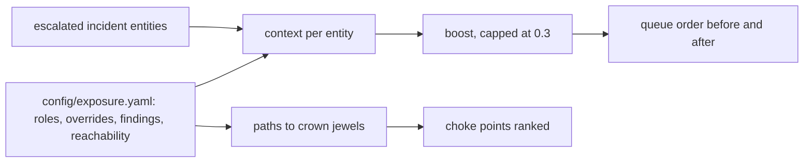

# Component: exposure context in triage

Two alerts with the same score are not equal if one host is a payroll server with a known-exploited flaw on
the path to the domain controller. This component adds asset criticality, open known-exploited findings and
attack-path position to each escalated incident, and reorders the analyst queue. It never changes a verdict.

Sections: [1. Purpose](#1-purpose) · [2. Architecture](#2-architecture) · [3. How it works](#3-how-it-works) · [4. Key files](#4-key-files) · [5. Code excerpts](#5-code-excerpts) · [6. Configuration](#6-configuration) · [7. Commands](#7-commands) · [8. Real output](#8-real-output) · [9. Tests and gates](#9-tests-and-gates) · [10. Guardrails](#10-guardrails) · [11. Security and governance](#11-security-and-governance) · [12. Observability](#12-observability) · [13. Failure modes](#13-failure-modes) · [14. Mapping to Azure services](#14-mapping-to-azure-services) · [15. Limitations](#15-limitations) · [16. Interview talking points](#16-interview-talking-points)

## 1. Purpose

* Put the most dangerous escalated incidents first, using context an analyst would otherwise look up by hand.
* Show the choke points: the systems that sit on the most routes to crown jewels.

## 2. Architecture



## 3. How it works

1. Criticality comes from the asset's role (domain controller, server, workstation, account type);
   crown jewels from the tenant model score 10. Overrides carry who set them and why.
2. Open findings use synthetic identifiers with a known-exploited flag; only flagged findings count.
3. A breadth-first search over "can reach" edges finds paths to crown jewels; nodes on more paths rank
   higher as choke points.
4. The boost (criticality, known-exploited findings, path position) is capped and only reorders the queue.

## 4. Key files

| File | Role |
|---|---|
| `src/aisoc/exposure.py` | Context, paths, choke points, queue ordering, evaluation |
| `config/exposure.yaml` | Roles, overrides, findings, reachability per tenant |
| `tests/test_exposure.py` | Criticality, overrides, findings, paths, cap, queue |

## 5. Code excerpts

<!-- code: src/aisoc/exposure.py::context -->
```python
def context(tenant: str, kind: str, asset: str) -> Context:
    cfg, t = config(), _tenant(tenant)
    ten = get(tenant)
    override = (t.get("overrides") or {}).get(asset)
    if kind == "host":
        h = t["hosts"].get(asset, {"role": "workstation"})
        crit = 10 if asset in ten.crown_jewels else cfg["roles"][h["role"]]
        src = "crown jewel" if asset in ten.crown_jewels else f"role {h['role']}"
        kev = tuple(f["id"] for f in h.get("findings", []) if f["kev"])
        paths = paths_to_jewels(tenant, asset)
    else:
        a = cfg["accounts"]
        if asset in ten.approvers or asset in ten.break_glass:
            crit, src = 9, "approver or break-glass account"
        elif asset.startswith(a["service_account_prefix"]):
            crit, src = a["service_account"], "service account"
        else:
            crit, src = a["default"], "standard user"
        kev, paths = (), []
    if override:
        crit, src = int(override["criticality"]), f"override by {override['by']}: {override['why']}"
    return Context(asset, kind, crit, src, kev, bool(paths), paths[0] if paths else ())
```
<!-- /code -->

<!-- code: src/aisoc/exposure.py::choke_points -->
```python
def choke_points(tenant: str) -> list[tuple[str, int]]:
    """Hosts ranked by how many entry-to-crown-jewel paths pass through them (entries = hosts with no inbound edge)."""
    t = _tenant(tenant)
    jewels = set(get(tenant).crown_jewels)
    inbound = {b for _, b in t["edges"]}
    entries = sorted({a for a, _ in t["edges"]} - inbound)
    counts: dict[str, int] = {}
    for e in entries:
        for p in paths_to_jewels(tenant, e):
            for node in p:
                if node not in jewels:
                    counts[node] = counts.get(node, 0) + 1
    return sorted(counts.items(), key=lambda kv: (-kv[1], kv[0]))
```
<!-- /code -->

## 6. Configuration

Everything is in `config/exposure.yaml`. `MAX_BOOST` in `exposure.py` caps the reorder weight.

## 7. Commands

```bash
aisoc exposure
aisoc exposure --tenant brightwater
```

## 8. Real output

Synthetic data; measured on the learning run.

<!-- output: exposure -->
```text
Exposure context in triage (Brightwater Logistics, synthetic)

Escalated queue (P = model probability, +X = exposure boost):
  #1  (was #1 ) INC-BR-015  P 0.998 +0.045
  #2  (was #2 ) INC-BR-027  P 0.998 +0.045
  #3  (was #3 ) INC-BR-036  P 0.983 +0.045
  #4  (was #5 ) INC-BR-008  P 0.599 +0.210
       svc.backup@brightwater.example: criticality 7/10 (service account); 0 open known-exploited finding(s); not on an attack path to a crown jewel
       BWL-BKP01: criticality 8/10 (role backup_server); 0 open known-exploited finding(s); on attack path BWL-BKP01 -> BWL-DC01
  #5  (was #4 ) INC-BR-001  P 0.707 +0.045
  #6  (was #6 ) INC-BR-004  P 0.450 +0.270
       BWL-ADM01: criticality 8/10 (role admin_workstation); 1 open known-exploited finding(s) SYN-WIN-2231; on attack path BWL-ADM01 -> BWL-DC01
  #7  (was #7 ) INC-BR-011  P 0.027 +0.270
       BWL-ADM01: criticality 8/10 (role admin_workstation); 1 open known-exploited finding(s) SYN-WIN-2231; on attack path BWL-ADM01 -> BWL-DC01
  #8  (was #8 ) INC-BR-016  P 0.021 +0.270
       BWL-ADM01: criticality 8/10 (role admin_workstation); 1 open known-exploited finding(s) SYN-WIN-2231; on attack path BWL-ADM01 -> BWL-DC01
  #9  (was #10) INC-BR-023  P 0.017 +0.270
       BWL-ADM01: criticality 8/10 (role admin_workstation); 1 open known-exploited finding(s) SYN-WIN-2231; on attack path BWL-ADM01 -> BWL-DC01
  #10 (was #11) INC-BR-029  P 0.014 +0.270
       BWL-ADM01: criticality 8/10 (role admin_workstation); 1 open known-exploited finding(s) SYN-WIN-2231; on attack path BWL-ADM01 -> BWL-DC01
  #11 (was #12) INC-BR-037  P 0.014 +0.270
       BWL-ADM01: criticality 8/10 (role admin_workstation); 1 open known-exploited finding(s) SYN-WIN-2231; on attack path BWL-ADM01 -> BWL-DC01
  #12 (was #9 ) INC-BR-013  P 0.018 +0.045

Endpoint pack hosts:
  BWL-WS07: criticality 3/10 (role workstation); 1 open known-exploited finding(s) SYN-BRW-3301; on attack path BWL-WS07 -> BWL-SRV03 -> BWL-ADM01 -> BWL-DC01
  BWL-SRV03: criticality 6/10 (role server); 1 open known-exploited finding(s) SYN-SMB-0907; on attack path BWL-SRV03 -> BWL-ADM01 -> BWL-DC01
  BWL-SRV02: criticality 2/10 (override by it.director@brightwater.example: test server, no production data); 0 open known-exploited finding(s); not on an attack path to a crown jewel
  BWL-MAC04: criticality 3/10 (role mac_workstation); 0 open known-exploited finding(s); on attack path BWL-MAC04 -> BWL-ERP01

Choke points (fix one, cut the most paths to a crown jewel):
  fixing BWL-BKP01 closes 2 path(s)
  fixing BWL-ADM01 closes 1 path(s)
  fixing BWL-MAC04 closes 1 path(s)
  fixing BWL-SRV03 closes 1 path(s)
  fixing BWL-WS07 closes 1 path(s)

Measured across all tenants (synthetic labels):
  escalated_incidents: 37
  true_positives_escalated: 9
  rank_changes: 20
  true_positives_in_top_slots_before: 9/9
  true_positives_in_top_slots_after: 9/9
  verdicts_or_tiers_changed: 0
```
<!-- /output -->

## 9. Tests and gates

`tests/test_exposure.py` (16 tests): crown jewels, attributed overrides, known-exploited filtering, paths,
bounded boost, choke-point order, verdicts and tiers unchanged. The "no verdict or tier changed" property is a test, not a gate check.

## 10. Guardrails

Context reorders; it never closes, escalates or contains. Overrides must name a person and a reason.

## 11. Security and governance

Findings and reachability are fictional and stored as data, not scanned. A production version would read
them from the vulnerability and attack-path tools through read-only access.

## 12. Observability

The queue prints rank before and after with the reasons, and choke points with their path counts.

## 13. Failure modes

| Failure | Effect | Handling |
|---|---|---|
| Stale criticality | Wrong order | Overrides are attributed and reviewable |
| Over-weighted context | Low-value alerts jump the queue | Boost capped at 0.3 |
| Missing reachability edge | Path not found | Limitation stated; path shown only when found |

## 14. Mapping to Azure services

| Here | In Azure |
|---|---|
| Criticality and reachability | Exposure data from an exposure-management tool, mirrored as Microsoft Sentinel watchlists |
| Known-exploited flags | Defender XDR vulnerability data with a known-exploited filter |
| Identity paths | Entra ID role and group data |
| Queue ordering | Foundry triage agent output; Azure Monitor workbook for the queue |

## 15. Limitations

* Reachability is hand-modelled for three small tenants.
* In this run the true positives were already at the top; the reorder changes 20 ranks among the rest.

## 16. Interview talking points

* "Context changes the order, never the verdict, and the tests prove it."
* "The backup server is the top choke point: two routes to crown jewels go through it."
