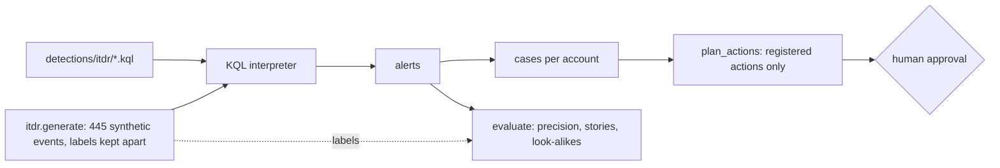

# Component: identity threat pack (Microsoft 365 and Entra ID)

Most small-business incidents start with an identity, not a binary: a stolen session token, a consent
grant to a rogue app, a device-code prompt, a legacy protocol that skips MFA, and then an inbox rule that
hides the security mail. This pack detects those five patterns over its own synthetic sign-in, consent and
mailbox telemetry, groups alerts per account, and proposes an approval-gated plan per case.

Sections: [1. Purpose](#1-purpose) · [2. Architecture](#2-architecture) · [3. How it works](#3-how-it-works) · [4. Key files](#4-key-files) · [5. Code excerpts](#5-code-excerpts) · [6. Configuration](#6-configuration) · [7. Commands](#7-commands) · [8. Real output](#8-real-output) · [9. Tests and gates](#9-tests-and-gates) · [10. Guardrails](#10-guardrails) · [11. Security and governance](#11-security-and-governance) · [12. Observability](#12-observability) · [13. Failure modes](#13-failure-modes) · [14. Mapping to Azure services](#14-mapping-to-azure-services) · [15. Limitations](#15-limitations) · [16. Interview talking points](#16-interview-talking-points)

## 1. Purpose

* Cover the identity attacks that dominate small-business compromise, with look-alikes that a naive rule
  would flag (a phone moving between home and mobile networks, meeting-room device-code sign-ins, a listed
  scan-to-email printer on SMTP AUTH, verified-publisher consent).
* Measure precision honestly, including the one false positive the pack still produces.

## 2. Architecture



## 3. How it works

1. `generate` builds a deterministic Orchid Valley Clinics tenant: normal sign-ins, four attack stories
   (token replay with an inbox rule, consent phishing, device-code phishing, legacy-auth spraying) and ten
   look-alike kinds. Ground truth sits in `PackData.labels`, which detection code never reads.
2. `detect` runs the six rules in `detections/itdr/` through the same KQL interpreter as the main rules.
3. `cases` groups alerts by account, ordered by first alert; `plan_actions` proposes revoke sessions,
   password reset, inbox-rule removal or app-grant revocation, each an action in the authority registry.
4. `evaluate` scores alerts against the labels and reports precision, stories detected and which
   look-alike kinds still alert.

## 4. Key files

| File | Role |
|---|---|
| `src/aisoc/itdr.py` | Telemetry, look-alikes, detection run, cases, plans, evaluation |
| `detections/itdr/rules.yaml` | Rule metadata: severity, stage, ATT&CK technique, entity column |
| `detections/itdr/*.kql` | The six queries |
| `tests/test_itdr.py` | Precision, stories, look-alikes, determinism, address ranges, plans |

## 5. Code excerpts

The token-replay query, then the grouping into cases:

<!-- code: detections/itdr/token-replay.kql -->
```kusto
// Session or token theft (adversary-in-the-middle replay): one sign-in session used from two or more
// autonomous systems, at least one of them a hosting or anonymising network. A phone moving from home
// broadband to its mobile carrier keeps the session but never touches a hosting network, so it is excluded.
let Risky = dynamic(["hosting", "anonymous-vpn"]);
SigninLogs
| where ResultType == "0" and isnotempty(SessionId)
| extend RiskyAsn = iff(AsnCategory in (Risky), 1, 0)
| summarize Asns = dcount(AutonomousSystemNumber), RiskyHits = sum(RiskyAsn), Devices = dcount(DeviceId), TimeGenerated = max(TimeGenerated), EventIds = make_set(EventId) by UserPrincipalName, SessionId
| where Asns >= 2 and RiskyHits >= 1
| project TimeGenerated, UserPrincipalName, SessionId, Asns, Devices, EventIds
```
<!-- /code -->

<!-- code: src/aisoc/itdr.py::cases -->
```python
def cases(alerts: list[Alert], window: timedelta = timedelta(hours=6)) -> list[Case]:
    """One case per account; alerts more than `window` after the last one open a new case."""
    out: list[Case] = []
    open_by: dict[str, Case] = {}
    for a in alerts:
        c = open_by.get(a.entity)
        if c is None or a.at - c.end > window:
            c = Case(f"ITDR-{len(out) + 1:03d}", a.entity, [])
            out.append(c)
            open_by[a.entity] = c
        c.alerts.append(a)
    return out
```
<!-- /code -->

## 6. Configuration

`detections/itdr/rules.yaml` holds the rule list. The tenant's own egress addresses, the meeting-room
device group and the listed scan-to-email devices are constants at the top of `itdr.py`
(`KNOWN_EGRESS`, `DEVICE_CODE_ALLOWED`, `LEGACY_ALLOWED`), standing in for named locations and groups.

## 7. Commands

```bash
aisoc itdr
aisoc timeline --incident ITDR-001
```

## 8. Real output

Synthetic data; the numbers are measured on it and are a regression check, not a quality claim.

<!-- output: itdr -->
```text
Identity threat pack (synthetic Orchid Valley Clinics week; documentation IP ranges, private-use ASNs)

ITDR-001  dana.ruiz@orchidvalley.example   D02 09:16  rules: hosting-or-vpn-signin, inbox-rule-hides-security-mail, token-replay
         > revoke_sessions dana.ruiz@orchidvalley.example (dry run, needs approval)
         > reset_password dana.ruiz@orchidvalley.example (dry run, needs approval)
         > remove_inbox_rule dana.ruiz@orchidvalley.example/.. (dry run, needs approval)
ITDR-002  gus.moreau@orchidvalley.example  D03 14:07  rules: oauth-consent-risky
         > revoke_oauth_grant gus.moreau@orchidvalley.example/QuickDoc Viewer Sync (dry run, needs approval)
ITDR-003  kai.lund@orchidvalley.example    D04 11:40  rules: device-code-signin, hosting-or-vpn-signin
         > revoke_sessions kai.lund@orchidvalley.example (dry run, needs approval)
         > reset_password kai.lund@orchidvalley.example (dry run, needs approval)
ITDR-004  omar.siddiqui@orchidvalley.example D05 02:09  rules: hosting-or-vpn-signin, legacy-auth-signin
         > revoke_sessions omar.siddiqui@orchidvalley.example (dry run, needs approval)
         > block_legacy_auth_for_user omar.siddiqui@orchidvalley.example (dry run, needs approval)
ITDR-005  lena.fischer@orchidvalley.example D06 21:30  rules: hosting-or-vpn-signin

Measured (regression check on synthetic data, not a quality claim):
  events: 445
  alerts: 11
  true_positive_alerts: 10
  false_positive_alerts: 1
  precision: 0.909
  stories_detected: 4/4
  lookalike_kinds: 10
  lookalike_kinds_alerting: ['traveller-commercial-vpn']
  cases: 5
  alerts_per_rule: {'token-replay': 1, 'oauth-consent-risky': 1, 'device-code-signin': 1, 'legacy-auth-signin': 2, 'hosting-or-vpn-signin': 5, 'inbox-rule-hides-security-mail': 1}
```
<!-- /output -->

## 9. Tests and gates

`tests/test_itdr.py` (18 tests): every story detected, the known false positive reported by name, all
rule files present, deterministic generation, documentation-range addresses only, plans use registered
actions only. The release gate (`aisoc gate`) includes "endpoint and identity packs detect every story".

## 10. Guardrails

Detection never reads labels. Plans are proposals; nothing runs without an approval bound to the plan
digest (see [authority-registry.md](authority-registry.md)). The hosting-or-VPN rule is an enrichment flag
at low severity and does not create a plan on its own.

## 11. Security and governance

Every name, address and app in the pack is fictional; addresses come from the documentation ranges. A
production version would read sign-in and audit logs through the read-only tool gateway with the same
per-tenant boundary as the main pipeline.

## 12. Observability

Alerts per rule, precision, stories detected and the look-alike kinds that still alert are printed on every run and checked by the gate.

## 13. Failure modes

| Failure | Effect | Handling |
|---|---|---|
| Traveller on a commercial VPN | One false positive (measured) | Reported by name; low severity; no plan on its own |
| Phone moves between networks | Would look like token replay | Rule needs a hosting or anonymising network |
| Admin consent workflow | Would look like consent phishing | Only user consent to unverified publishers alerts |
| Shared meeting-room device code | Would look like device-code phishing | Allowed device group excluded |

## 14. Mapping to Azure services

| Here | In Azure |
|---|---|
| Synthetic sign-in, consent, mailbox tables | Entra ID sign-in and audit logs, Exchange audit in Microsoft Sentinel |
| Rules in `detections/itdr/` | Microsoft Sentinel analytics rules (planned; not in rules.json) |
| Product signals | Defender XDR identity and cloud-app alerts |
| Narrative and triage | Foundry agent through the existing guardrails |
| Run metrics | Azure Monitor workbook |

## 15. Limitations

* Small synthetic tenant; real tenants have far more travel, VPN and device diversity.
* The rules are not yet exported to rules.json, so the IaC does not deploy them.
* The hosting-network flag uses a static list; a real deployment needs a maintained feed.

## 16. Interview talking points

* "Four identity attack stories, ten look-alike kinds, one false positive that I report by name instead of hiding."
* "The inbox rule that hides security mail is the tell that turns a sign-in oddity into a confirmed takeover."
* "Every case ends in a plan of registered actions waiting for approval; the pack never acts on its own."
