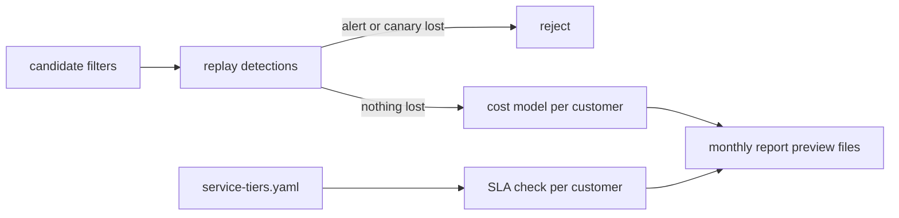

# Component: service tiers, log-filter costs and monthly client reports

The operating side of a small-business SOC: what each customer buys, whether the SLA was met, how much log
ingest a filter would save without losing detections, and a monthly report per customer. All data is
synthetic and all prices are assumptions; reports are preview files and nothing is sent.

Sections: [1. Purpose](#1-purpose) · [2. Architecture](#2-architecture) · [3. How it works](#3-how-it-works) · [4. Key files](#4-key-files) · [5. Code excerpts](#5-code-excerpts) · [6. Configuration](#6-configuration) · [7. Commands](#7-commands) · [8. Real output](#8-real-output) · [9. Tests and gates](#9-tests-and-gates) · [10. Guardrails](#10-guardrails) · [11. Security and governance](#11-security-and-governance) · [12. Observability](#12-observability) · [13. Failure modes](#13-failure-modes) · [14. Mapping to Azure services](#14-mapping-to-azure-services) · [15. Limitations](#15-limitations) · [16. Interview talking points](#16-interview-talking-points)

## 1. Purpose

* Package the service in three tiers with SLA targets and report breaches honestly.
* Model ingest savings per customer and reject any filter that would hide an alert or a planted canary.
* Produce a monthly report per customer as Markdown, HTML and CSV preview files.

## 2. Architecture



## 3. How it works

1. `smartfilter.replay` applies filters to each tenant's store, re-runs detections and lists lost alerts;
   planted canary rows make sure a filter cannot hide what no current rule needs yet.
2. `costs` moves filtered rows from the analytics price to the archive price and reports a modelled saving.
3. `tiers.sla` compares MTTD, acknowledgement and simulated MTTR against the customer's tier.
4. `monthly.build` collects incidents, stories, SLA results and choke-point recommendations; `write`
   saves preview files under `out/monthly/`, which is not committed. There is no send function.

## 4. Key files

| File | Role |
|---|---|
| `src/aisoc/smartfilter.py` | Filter replay and cost model |
| `src/aisoc/tiers.py` | Tier lookup and SLA check |
| `src/aisoc/monthly.py` | Monthly report preview files |
| `config/smart-filter.yaml` | Filters, canaries, assumed prices |
| `config/service-tiers.yaml` | Tiers, SLA targets, customer map |
| `tests/test_service_ops.py` | Filters, tiers, reports, CLI commands |

## 5. Code excerpts

<!-- code: src/aisoc/smartfilter.py::decide -->
```python
@cache
def decide() -> tuple[list[dict], dict[str, dict[str, list[str]]]]:
    accepted, rejected = [], {}
    for f in config()["filters"]:
        hidden = [c["why"] for c in config().get("canaries", []) if c["table"] == f["table"] and matches(f, c["row"])]
        if hidden:
            rejected[f["id"]] = {"planted canary": hidden}
            continue
        lost = replay([*accepted, f])
        if any(lost.values()):
            rejected[f["id"]] = {t: v for t, v in lost.items() if v}
        else:
            accepted.append(f)
    return accepted, rejected
```
<!-- /code -->

<!-- code: src/aisoc/tiers.py::sla -->
```python
def sla(run, tenant: str) -> dict:
    from aisoc import metrics

    t = tier_of(tenant)
    target = t["sla_min"]
    stories = [s for s in metrics.stories(run) if s.tenant == tenant]
    acks = [
        round((c.decision.decided_at - c.incident.start).total_seconds() / 60, 1)
        for c in run.tenants[tenant].cases
        if c.route.tier >= 2 and c.decision
    ]
    breaches = []
    for s in stories:
        if s.mttd_min is None:
            breaches.append(f"{s.story}: not detected")
        elif s.mttd_min > target["mttd"]:
            breaches.append(f"{s.story}: MTTD {s.mttd_min} min > {target['mttd']}")
        if s.mttr_min is not None and s.mttr_min > target["mttr"]:
            breaches.append(f"{s.story}: simulated MTTR {s.mttr_min} min > {target['mttr']}")
    late_acks = [a for a in acks if a > target["ack"]]
    if late_acks:
        breaches.append(f"{len(late_acks)} escalated incident(s) acknowledged after {target['ack']} min (worst {max(late_acks)})")
    return {
        "tenant": tenant,
        "customer": get(tenant).name,
        "tier": t["name"],
        "targets": target,
        "stories": len(stories),
        "mttd_max": max((s.mttd_min for s in stories if s.mttd_min is not None), default=None),
        "ack_median": statistics.median(acks) if acks else None,
        "ack_max": max(acks) if acks else None,
        "mttr_max_simulated": max((s.mttr_min for s in stories if s.mttr_min is not None), default=None),
        "breaches": breaches,
    }
```
<!-- /code -->

## 6. Configuration

Prices are labelled assumptions in `config/smart-filter.yaml`; tiers in `config/service-tiers.yaml`.

## 7. Commands

```bash
aisoc smart-filter
aisoc tiers
aisoc monthly-report --tenant pinecrest
aisoc monthly-report --tenant pinecrest --write
```

## 8. Real output

Synthetic data and assumed prices.

<!-- output: smart-filter -->
```text
Log filtering simulation (synthetic volumes, ASSUMED prices)

ACCEPTED  office-apps-from-explorer (DeviceProcessEvents): a person opening Teams, Edge, Excel or Outlook from the desktop; no detection reads these
REJECTED  internal-mail-no-url-no-threat (EmailEvents): would hide a planted canary: internal account sending mail after takeover (no link, no verdict yet)
REJECTED  browser-https (DeviceNetworkEvents): would hide a planted canary: browser-delivered beacon to a threat-intel address

  tenant           rows  archived   share   saving
  brightwater      5883       900   15.3%    16.4%
  orchidvalley     5086       780   15.3%    16.5%
  pinecrest        5625       840   14.9%    16.0%

Saving uses assumed per-GB prices from config/smart-filter.yaml; the replay check is the real result.

Measured:
  candidate_filters: 3
  accepted: ['office-apps-from-explorer']
  rejected: {'internal-mail-no-url-no-threat': 1, 'browser-https': 1}
  alerts_lost_with_accepted_filters: 0
  rows_archived_share: {'brightwater': 0.153, 'orchidvalley': 0.153, 'pinecrest': 0.149}
  modelled_saving_pct: {'brightwater': 16.4, 'orchidvalley': 16.5, 'pinecrest': 16.0}
```
<!-- /output -->

<!-- output: tiers -->
```text
Service tiers (fictional packaging; SLAs in minutes)

Essentials  MTTD  60  ack 240  MTTR 480  business hours human review; automation always on
            for small offices that need identity and email covered; covers identity sign-ins, email and links, cloud file activity
Standard    MTTD  45  ack 120  MTTR 240  24x7 human review
            for companies with endpoints and servers to protect; covers identity sign-ins, email and links, cloud file activity, endpoints and servers
Plus        MTTD  30  ack  60  MTTR 180  24x7 human review with a named lead analyst
            for regulated customers (health, finance) with crown-jewel systems; covers identity sign-ins, email and links, cloud file activity, endpoints and servers, identity threat pack, exposure context

Brightwater Logistics (Standard): 3 attack stories, worst MTTD 60.0 min, ack median 80.0 / worst 265.0 min, worst simulated MTTR 265.0 min
    BREACH brightwater-phish-d16: simulated MTTR 265.0 min > 240
    BREACH brightwater-insider-d19: MTTD 60.0 min > 45
    BREACH 1 escalated incident(s) acknowledged after 120 min (worst 265.0)
Orchid Valley Clinics (Plus): 2 attack stories, worst MTTD 33.0 min, ack median 80.0 / worst 240.0 min, worst simulated MTTR 240.0 min
    BREACH orchidvalley-phish-d6: simulated MTTR 240.0 min > 180
    BREACH orchidvalley-ransomware-d18: MTTD 33.0 min > 30
    BREACH 12 escalated incident(s) acknowledged after 60 min (worst 240.0)
Pinecrest Credit Union (Essentials): 4 attack stories, worst MTTD 60.0 min, ack median 80.0 / worst 1228.0 min, worst simulated MTTR 152.0 min
    BREACH 1 escalated incident(s) acknowledged after 240 min (worst 1228.0)
```
<!-- /output -->

<!-- output: monthly-report --tenant pinecrest -->
```text
# Monthly security report: Pinecrest Credit Union

Service tier: **Essentials**. Synthetic data; preview only, not sent.

| Measure | Value |
|---|---|
| incidents | 37 |
| closed automatically | 24 |
| sent to an analyst | 13 |
| verdict: confirmed attack | 4 |
| verdict: false alarm | 19 |
| verdict: real activity, approved | 14 |
| attack stories | 4 |
| attack stories detected | 4 |
| worst MTTD (min) | 60.0 |
| worst simulated MTTR (min) | 152.0 |
| reports sent without analyst reading first (consensus) | 0 |
| containment actions approved and run (dry run) | 12 |
| containment actions run without approval | 0 |
| SLA breaches | 1 |
| log rows moved to archive tier (share) | 0.149 |
| modelled ingestion saving (assumed prices, %) | 16.0 |

## Attacks this month

| Story | Started | MTTD (min) | Simulated MTTR (min) | Contained |
|---|---|---|---|---|
| pinecrest-ransomware-d5 | D05 22:30 | 33.0 | 152.0 | yes |
| pinecrest-insider-d11 | D11 21:00 | 60.0 | 115.0 | yes |
| pinecrest-spray-d17 | D17 03:00 | 20.0 | 100.0 | yes |
| pinecrest-travel-d20 | D20 08:00 | 60.0 | 80.0 | yes |

## Recommendations

- Fix the access path through PCU-ADM01: it is on 1 route(s) to a crown-jewel system.
- Fix the access path through PCU-BKP01: it is on 1 route(s) to a crown-jewel system.
- SLA: 1 escalated incident(s) acknowledged after 240 min (worst 1228.0).
```
<!-- /output -->

## 9. Tests and gates

`tests/test_service_ops.py` (28 tests), including tenant isolation of each report, HTML escaping and the
absence of any send path. Gate check: "log filters lose no alert".

## 10. Guardrails

No filter that loses an alert or a canary is accepted. Reports are files only. Each report holds one tenant's data.

## 11. Security and governance

Customer names are fictional. Real prices vary by region and commitment; the numbers here are assumptions.

## 12. Observability

The SLA check prints every breach with the story or incident that caused it.

## 13. Failure modes

| Failure | Effect | Handling |
|---|---|---|
| Filter drops data a future rule needs | Silent blind spot | Planted canaries reject it |
| SLA miss hidden in an average | Customer surprise | Worst case and every breach printed |
| Report includes another tenant | Data leak | Tested per tenant |

## 14. Mapping to Azure services

| Here | In Azure |
|---|---|
| Filters | Data collection rule transformations in Azure Monitor |
| Archive tier | Microsoft Sentinel auxiliary or archive logs |
| SLA timings | Microsoft Sentinel incident timestamps, Defender XDR alert times |
| Report delivery | Not built; a Foundry narrative with approval and Entra ID-scoped sharing is planned |

## 15. Limitations

* Prices are assumptions, not quotes.
* MTTR is the repository's simulated value, so the MTTR SLA check is a model check.
* Delivery of reports is not built on purpose.

## 16. Interview talking points

* "Two of three filters were rejected: one would have hidden a canary no current rule needs."
* "The SLA report shows the breaches, including on the top tier."
