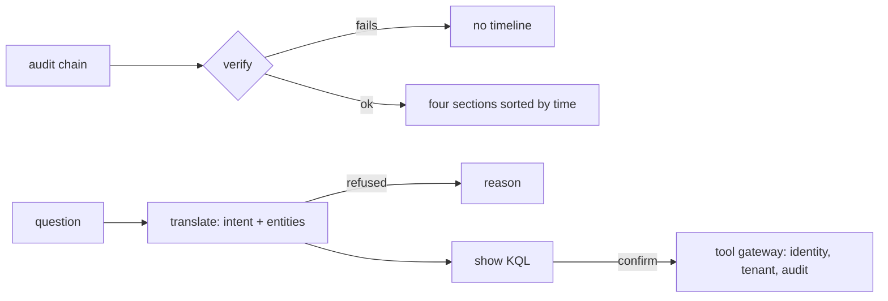

# Component: incident timeline and plain-English search

Two analyst helpers. The timeline turns a verified audit chain into four plain sections: how they got in,
what they did, what we checked and when they were evicted. The search turns a plain-English question into an
allow-listed KQL template, shows the query, and runs it only after the analyst confirms.

Sections: [1. Purpose](#1-purpose) · [2. Architecture](#2-architecture) · [3. How it works](#3-how-it-works) · [4. Key files](#4-key-files) · [5. Code excerpts](#5-code-excerpts) · [6. Configuration](#6-configuration) · [7. Commands](#7-commands) · [8. Real output](#8-real-output) · [9. Tests and gates](#9-tests-and-gates) · [10. Guardrails](#10-guardrails) · [11. Security and governance](#11-security-and-governance) · [12. Observability](#12-observability) · [13. Failure modes](#13-failure-modes) · [14. Mapping to Azure services](#14-mapping-to-azure-services) · [15. Limitations](#15-limitations) · [16. Interview talking points](#16-interview-talking-points)

## 1. Purpose

* Give customers and analysts a readable incident story that comes from the tamper-evident record, not
  from a model's memory.
* Let junior analysts and customers ask questions without writing KQL, while keeping the query visible
  and the tool gateway in charge.

## 2. Architecture



## 3. How it works

1. `timeline.build` verifies the chain, selects records for one incident and sorts each section by time
   and sequence. A tampered chain produces no timeline.
2. Identity-pack cases are written to an audit log by `record_itdr_case`; main-pipeline incidents show that
   entry steps were not logged, rather than inventing them.
3. `nlsearch.translate` strips addresses first, matches an intent to a template, fills parameters and
   refuses query syntax or unclear questions. `run` needs `confirm=True` and goes through the gateway.

## 4. Key files

| File | Role |
|---|---|
| `src/aisoc/timeline.py` | Timeline from the audit chain |
| `src/aisoc/nlsearch.py` | Question to template, refusal rules, confirm-to-run |
| `config/kql-templates.yaml` | The allow-listed templates the search can use |
| `tests/test_timeline_search.py` | Sections, tamper, scoping, refusals, confirm |

## 5. Code excerpts

<!-- code: src/aisoc/timeline.py::build -->
```python
def build(audit: AuditLog, incident: str, t0: datetime) -> dict:
    ok, msg = audit.verify()
    if not ok:
        raise ValueError(f"audit chain does not verify ({msg}); no timeline produced")
    recs = records_for(audit, incident)
    alerts = [r for r in recs if r["event"] == "alert.raised"]
    entry = [r for r in alerts if r["data"]["stage"] in ENTRY_STAGES][:1] or alerts[:1]
    sections = {
        "How they got in": entry,
        "What they did": [r for r in alerts if r not in entry],
        "What we checked": [
            r for r in recs if r["event"] in ("triage.scored", "case.routed", "case.auto_closed", "tool.call", "tool.denied", "case.reviewed")
        ],
        "When they were evicted": [r for r in recs if r["event"].startswith(("containment.", "approval."))],
    }
    return {
        "incident": incident,
        "chain": msg,
        "records": len(recs),
        "sections": {
            k: [(_when(r["at"], t0), r["seq"], _line(r)) for r in sorted(v, key=lambda r: (r["at"] or "", r["seq"]))] for k, v in sections.items()
        },
    }
```
<!-- /code -->

<!-- code: src/aisoc/nlsearch.py::translate -->
```python
def translate(question: str) -> Translation:
    q = question.strip()
    if KQL_SMELL.search(q):
        return Translation(q, None, {}, None, "the question contains query syntax; plain English only (analysts can use raw KQL in hunting)")
    ents = {"upn": UPN.findall(q), "ip": IP.findall(q), "host": HOST.findall(q), "domain": DOMAIN.findall(UPN.sub(" ", q))}
    if sum(len(v) for v in ents.values()) == 0:
        return Translation(q, None, {}, None, "name one account, device, address or domain to search for")
    if sum(len(v) > 0 for v in ents.values()) > 1 or any(len(v) > 1 for v in ents.values()):
        return Translation(q, None, {}, None, "ask about one account, device, address or domain at a time")
    low = q.lower()
    for template, ent, words in INTENTS:
        if ents[ent] and any(w in low for w in words):
            params = {ent: ents[ent][0], "lookback": _lookback(q), "until": "0h"}
            try:
                return Translation(q, template, params, render_template(template, params))
            except ToolDenied as e:
                return Translation(q, template, params, None, f"refused by the template's parameter check: {e}")
    return Translation(q, None, {}, None, "could not tell what to look for; try words like sign-ins, email, clicks, processes or connections")
```
<!-- /code -->

## 6. Configuration

Templates are in `config/kql-templates.yaml`; intents and refusal patterns are constants in `nlsearch.py`.

## 7. Commands

```bash
aisoc timeline --incident ITDR-001
aisoc search "show logins for tom.baker@brightwater.example last 72 hours"
aisoc search "..." --confirm --tenant brightwater
```

## 8. Real output

Timeline from synthetic audit records:

<!-- output: timeline -->
```text
Timeline for ITDR-001 (from 14 audit records; chain: 44 records verified)

How they got in:
  D02 09:16  #1    hosting-or-vpn-signin (T1078.004): sign-in succeeded for dana.ruiz@orchidvalley.example via Browser from 203.0.113.200 (hosting network)

What they did:
  D02 09:16  #2    token-replay (T1550.004): sign-in succeeded for dana.ruiz@orchidvalley.example via Browser from 198.51.100.103 (residential network)
  D02 09:21  #3    inbox-rule-hides-security-mail (T1564.008): inbox rule '..' created in dana.ruiz@orchidvalley.example (words: security, mfa, password, unusual sign-in; folder: RSS Feeds)

What we checked:
  D02 09:21  #4    triage agent scored it true positive (P 0.950)

When they were evicted:
  D02 09:21  #5    containment proposed: revoke_sessions dana.ruiz@orchidvalley.example, reset_password dana.ruiz@orchidvalley.example, remove_inbox_rule dana.ruiz@orchidvalley.example/..
  D02 09:46  #6    ciso@orchidvalley.example approved plan c30c76d263fae221
  D02 09:46  #7    revoke_sessions dana.ruiz@orchidvalley.example (dry-run)
  D02 09:46  #8    reset_password dana.ruiz@orchidvalley.example (dry-run)
  D02 09:46  #9    remove_inbox_rule dana.ruiz@orchidvalley.example/.. (dry-run)
  D02 09:51  #10   verified at T+5 min: revoke_sessions dana.ruiz@orchidvalley.example holds
  D02 09:51  #12   verified at T+5 min: reset_password dana.ruiz@orchidvalley.example holds
  D02 09:51  #13   verified at T+5 min: remove_inbox_rule dana.ruiz@orchidvalley.example/.. holds
  D02 10:46  #11   verified at T+60 min: revoke_sessions dana.ruiz@orchidvalley.example holds
  D02 10:46  #14   verified at T+60 min: remove_inbox_rule dana.ruiz@orchidvalley.example/.. holds
```
<!-- /output -->

Search regression set (24 questions written with the code, not a held-out set):

<!-- output: search -->
```text
Plain-English search (allow-listed templates; shows the query, runs only on confirm)

Q: what did tom.baker@brightwater.example sign in from in the last 2 days?
   template user_signins with {'upn': 'tom.baker@brightwater.example', 'lookback': '48h', 'until': '0h'}
     SigninLogs
     | where UserPrincipalName =~ "tom.baker@brightwater.example" and TimeGenerated >= ago(48h) and TimeGenerated <= ago(0h)
     | project TimeGenerated, EventId, UserPrincipalName, IPAddress, Country = Location, ResultType, AppDisplayName
     | order by TimeGenerated asc
   (not run: pass --confirm to run it through the tool gateway)

Q: what did BWL-ADM01 connect to?
   template host_network with {'host': 'BWL-ADM01', 'lookback': '48h', 'until': '0h'}
     DeviceNetworkEvents
     | where DeviceName == "BWL-ADM01" and TimeGenerated >= ago(48h) and TimeGenerated <= ago(0h)
     | project TimeGenerated, EventId, DeviceName, RemoteIP, RemotePort, RemoteUrl, InitiatingProcessFileName
     | order by TimeGenerated asc
   (not run: pass --confirm to run it through the tool gateway)

Q: sign-ins for tom.baker@brightwater.example | union SecurityEvent
   refused: the question contains query syntax; plain English only (analysts can use raw KQL in hunting)

Measured on the labelled question set:
  questions: 24
  correct: 24/24
  mapped_correctly: 15/15
  refused_correctly: 9/9
  wrong: []
  queries_run_without_confirm: 0
```
<!-- /output -->

## 9. Tests and gates

`tests/test_timeline_search.py` (20 tests). Gate check: "plain-English search refuses every unsafe question".

## 10. Guardrails

No raw KQL from users; templates only; confirm before run; identity and tenant checks in the gateway.

## 11. Security and governance

The timeline cites audit sequence numbers so every line can be traced to a hash-chained record.

## 12. Observability

Each search prints the template and the filled query before anything runs; runs are audited by the gateway.

## 13. Failure modes

| Failure | Effect | Handling |
|---|---|---|
| Tampered audit record | False story | Chain verification fails, no timeline |
| Injection in a question | Arbitrary query | Query syntax refused; parameters validated by template regexes |
| Ambiguous question | Wrong query | Refused with a hint |

## 14. Mapping to Azure services

| Here | In Azure |
|---|---|
| Audit chain | Immutable storage plus Microsoft Sentinel incident comments |
| Templates and gateway | Microsoft Sentinel queries through a read-only tool layer |
| Signed-in analyst | Entra ID |
| Translation | Rule-based here; a Foundry model could propose a template, still from the allow-list |
| Endpoint and identity data | Defender XDR tables; Azure Monitor for query auditing |

## 15. Limitations

* Translation is rule-based, so phrasing outside the patterns is refused.
* The 24-question set is a regression set, not a measure of real-world accuracy.

## 16. Interview talking points

* "The search shows the KQL before it runs, so analysts learn the language instead of trusting a box."
* "If the audit chain does not verify, there is no timeline, by design."
